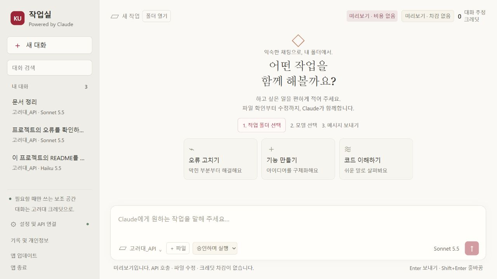

# KU 작업실

고려대 Gateway를 채팅 화면으로 사용하는 **비공식 로컬 작업 앱**입니다. Powered by Claude.
앱 아이콘을 누르고 작업 폴더를 고른 뒤 원하는 일을 한국어로 적으면 됩니다.
터미널은 처음 설치할 때 한 번만 사용합니다. Node·Git·Claude CLI를 따로 설치할 필요가 없습니다.

일반 Claude와 일반 Claude Code는 기존 구독 환경을 계속 사용합니다.
**KU 작업실에서 보낸 작업은 본인의 고려대 Gateway 크레딧을 사용합니다.**
구독 한도를 확인해 자동 전환하는 기능은 없습니다. 필요할 때 이 앱을 직접 여세요.

## Windows 설치

Windows 11 x64를 지원합니다. 관리자 권한은 필요 없습니다.

1. `Win + R`을 누르고 `powershell`을 입력한 뒤 Enter를 누르세요.
2. 아래 **한 줄 전체**를 붙여넣고 Enter를 누르세요.
3. 설치가 끝나면 바탕화면의 **KU 작업실**을 여세요.

```powershell
& { $p = Join-Path ([IO.Path]::GetTempPath()) ('KU-Setup-' + [Guid]::NewGuid().ToString('N') + '.ps1'); Invoke-WebRequest -UseBasicParsing 'https://github.com/Poby-ya/ku-workspace-releases/releases/latest/download/install-windows.ps1' -OutFile $p; try { & powershell.exe -NoProfile -ExecutionPolicy Bypass -File $p } finally { Remove-Item -LiteralPath $p -Force -ErrorAction SilentlyContinue } }
```

사용자 홈의 `.ku-workspace/app`에 설치하고 바로가기를 만듭니다.
시스템 전체 실행 정책이나 일반 Claude 설정을 바꾸지 않습니다.

## Mac 설치

macOS 13 이상, Apple Silicon(M 시리즈)과 Intel Mac을 지원합니다. CPU를 자동으로 구분합니다.

1. `Command + Space`를 누르고 **터미널**을 검색해 여세요.
2. 아래 한 줄을 붙여넣고 Enter를 누르세요.
3. `사용자 홈 → Applications → KU 작업실` 또는 바탕화면의 앱 아이콘을 여세요.

```bash
/bin/bash -c "$(curl -fsSL https://github.com/Poby-ya/ku-workspace-releases/releases/latest/download/install-mac.sh)"
```

첫 버전은 유료 개발자 인증 없이 배포합니다. macOS가 실행 확인을 요구하면
**시스템 설정 → 개인정보 보호 및 보안**에서 KU 작업실의 실행을 확인하세요.
키체인 접근 요청은 저장된 API 키를 보호하기 위한 것입니다. 거절하면 평문 저장으로 대체하지 않습니다.
업데이트 후 키체인 재확인이나 API 키 재입력이 필요할 수 있습니다.
보안 기능을 자동으로 끄거나 격리 표시를 일괄 제거하지 않습니다.

**Mac 자동 제작·기동 시험과 실제 Mac 사용자의 첫 설치 확인은 구분합니다.**
실제 기기의 설치·키체인·작업 승인 확인 전에는 전체 Mac 검증 완료로 표시하지 않습니다.

## 처음 사용할 때

1. **설정 및 API 연결**에서 BAZE가 발급한 본인의 API 키를 입력하세요. 키를 채팅창에 보내지 마세요.
2. **작업 폴더 선택**으로 실제 프로젝트 폴더를 고르세요.
3. 모델과 작업 모드를 고른 뒤 요청을 입력하세요. Enter는 보내기, Shift+Enter는 줄바꿈입니다.

기존 Windows 실행기에서 저장한 키는 앱 내부에서 암호화 형식을 이전합니다.
다른 컴퓨터에서는 본인의 키를 다시 입력해야 합니다. 키·대화는 기기 사이에 자동 동기화되지 않습니다.

## 화면에서 할 수 있는 일

| 기능 | 사용법 |
|---|---|
| 폴더 선택 | 아래 폴더 버튼. 최근 폴더와 전체 경로를 확인할 수 있습니다. |
| 폴더 열기 | 위쪽 **폴더 열기**로 탐색기 또는 Finder를 엽니다. |
| 다른 프로젝트 | 기본 폴더를 바꾸면 새 대화로 시작합니다. 기존 대화는 보존됩니다. |
| 추가 폴더 | **추가 폴더 허용**. 다음 작업부터 함께 접근할 수 있습니다. |
| 파일 참조 | **＋ 파일** 또는 입력창으로 끌어놓기. 보내기 전에 ×로 제거할 수 있습니다. |
| 모델 변경 | 작업이 멈춘 상태에서 바꾸면 같은 대화의 다음 요청에 적용됩니다. |
| 계획만 | 변경·명령 실행을 허용하지 않고 방향을 검토합니다. 실행할 때 모드를 직접 바꾸세요. |
| 승인하며 실행 | Claude Code의 기본 권한 규칙을 사용합니다. 필요한 승인·확인 질문을 버튼으로 처리합니다. |
| 대화 관리 | 검색, 이름 변경, Markdown 내보내기, 대화 삭제. 마지막 대화를 다시 열어줍니다. |
| 작업 중지 | **멈추기**. 이미 발생한 사용량이 취소되지는 않습니다. |

프로젝트의 `CLAUDE.md`와 프로젝트 설정을 읽습니다. 미리 허용된 작업은 승인 창 없이 실행될 수 있습니다.
수정 전마다 무조건 묻는다고 보장하지 않습니다. 프로젝트에 다른 API 인증·접속 설정이 있으면
충돌을 안내하고 실행을 중단합니다. 일반 Claude의 구독 인증·사용자 플러그인을 자동으로 가져오지 않습니다.
터미널 전용 `/명령`은 화면 버튼으로 대체하세요.

## 토큰과 크레딧

화면 열기, 대화 검색, 폴더·파일 선택, 이름 변경에는 모델 생성 호출이 없습니다.
참조 파일은 보내기 이후 Claude가 읽을 때 문맥에 포함되어 사용량에 영향을 줄 수 있습니다.
메시지 응답·도구 작업·긴 대화 요약에는 사용량이 발생합니다. 별도 AI 제목 생성은 사용하지 않습니다.

- **대화 추정 크레딧:** Claude Code의 누적 비용을 환산한 값이며 실제 Gateway 요금과 다를 수 있습니다.
- **계정 잔액:** 공식 잔액 API가 지원되면 표시합니다. 미지원·실패 시 ‘잔액 조회 불가’로 표시합니다.
- 실제 잔액과 차감은 BAZE의 내역이 기준입니다. 중지한 작업의 사용량이 추정치에 덜 반영될 수 있습니다.

Gateway가 허용한 Claude 모델만 선택할 수 있습니다. 기본은 지원되는 Sonnet 모델입니다.
기존 모델이 사라졌으면 자동으로 다른 고가 모델을 호출하지 않고 변경을 안내합니다.

## 입력 내용은 얼마나 남나요?

| 기록 | 보관 기준 |
|---|---|
| 앱의 대화와 이어가기 기록 | 직접 삭제할 때까지 장기 보관 |
| 프로젝트 공유 기억 | 프로젝트 기록 또는 전체 기록을 삭제할 때까지 |
| 진단 기록 | 오류 코드·시간·앱 버전만 7일. 입력문·응답·키는 넣지 않음 |
| API 키 | Windows 계정 암호화 또는 Mac 키체인 기반 암호화로 보호 |
| Gateway·모델 제공사의 서버 기록 | 고려대 경로에 적용되는 정확한 보관 기간은 미확인 |

**키 암호화와 대화 기록 암호화는 별개입니다. 대화·도구 기록은 로컬 평문입니다.**
기록에는 입력한 내용, 읽은 파일 내용, 도구 결과가 포함될 수 있습니다.

**기록 및 개인정보**에서 저장 위치와 용량을 확인할 수 있습니다.
개별 대화 삭제는 이어가기·관련 임시 기록도 지우며 프로젝트 공유 기억은 유지합니다.
프로젝트 기록 삭제는 해당 프로젝트의 모든 대화와 공유 기억을, 전체 기록 삭제는 고려대 프로필의 작업 기록을 지웁니다.
원본 작업 파일과 API 키는 삭제하지 않습니다. 직접 내보낸 파일은 별도로 관리해야 합니다.
로컬 삭제가 Gateway 서버 기록 삭제를 의미하지는 않습니다.

저장 위치는 두 운영체제 모두 사용자 홈의 `.claude-ku`입니다. 일반 구독용 `.claude`와 분리됩니다.
기존 30일 자동 정리로 이어가기 기록이 사라지지 않도록 고려대 세션에 장기 보관 설정을 적용합니다.

[Claude 로컬 기록 안내](https://code.claude.com/docs/en/claude-directory#application-data) ·
[Gateway 안내](https://docs.mindlogic.ai/docs/general/api-gateway/getting-started/overview)

## 업데이트와 문제 해결

**앱 업데이트**를 누르거나 처음 설치한 한 줄을 다시 실행하세요. 먼저 진행 중인 작업을 멈춰 주세요.
다운로드 검증·교체 실패 시 기존 앱을 보존하거나 이전 버전으로 복구합니다. 대화와 키는 앱 설치 폴더와 별도입니다.

| 안내 | 해야 할 일 |
|---|---|
| 키가 거절됨 | BAZE에서 유효한 본인의 키를 확인하고 설정에서 다시 연결 |
| 사용 한도·잔액 안내 | BAZE 사용량과 잔액 확인 |
| 모델 미지원 | 멈춘 상태에서 모델 목록의 다른 모델 선택 |
| 폴더가 이동됨 | 새 대화에서 현재 프로젝트 폴더 선택 |
| 이어가기 기록 없음 | 화면 기록을 내보내거나 참조해 새 대화로 시작 |
| 설치 파일 검증 실패 | 인터넷 연결 확인 후 설치 명령 다시 실행 |
| 프로젝트 API 설정 충돌 | 프로젝트의 별도 API 설정을 분리한 뒤 다시 실행 |
| Mac 저장된 키를 열 수 없음 | 키체인 접근 확인 후 설정에서 본인 키 재입력 |

[설치 파일·한국어 안내](https://github.com/Poby-ya/ku-workspace-releases)
개발 소스는 별도의 비공개 저장소에서 관리합니다.

## 화면 미리보기

아래 화면은 모의 작업으로 확인한 화면입니다. 실제 API 키와 모델 호출을 사용하지 않았습니다.


